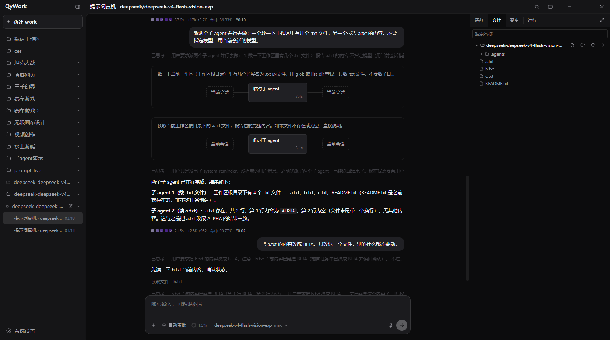

# qywork

qywork 是一个面向真实软件工程任务的**开源 Agent Harness**，同时提供可以直接使用的本地 AI
编程 Agent。

打开一个项目目录后，你可以直接让它阅读代码、修改文件、运行命令和测试。每次任务的执行过程、
文件变化、模型请求、token 用量和停止原因都会保存在本机。

## Agent = Model + Harness

模型提供理解与判断能力。Harness 负责把模型放进真实环境，让它能够使用工具、根据执行结果继续
判断，并把一项任务稳定地运行到完成或明确停止。

qywork 的 Harness 负责三件核心工作：

- **理解环境**：把工作区、项目状态和必要上下文交给模型；
- **执行任务**：让模型读取和修改文件、运行命令与测试，并根据结果继续工作；
- **记录过程**：保存每次 Run 的步骤、工具结果、文件变化、用量和停止原因。

模型可以替换，工具和扩展可以增加，但任务始终沿同一条运行主线执行，桌面端、浏览器和主动开启
后的手机访问看到的也是同一份状态。

[下载 Windows 版](https://github.com/qingxueyanshang/qywork-qingyan-harness/releases/latest) ·
[从源码启动](#从源码启动) · [开发文档](docs/INDEX.md)



## 核心特色

- **本地优先的完整工作台**：不需要注册 qywork 账号。会话、文件、Git 变更、运行详情、用量、
  终端、内嵌浏览器和扩展设置集中在同一个桌面界面中。
- **一个内核，同一份任务状态**：桌面端、浏览器和主动开启后的手机访问都连接 `qy`，
  不为不同入口维护第二套会话或执行逻辑。
- **兼容所有通过主流协议接入的模型**：模型目录不是白名单，可以填写任意 model id；通过
  Anthropic Messages、OpenAI Chat Completions 或 OpenAI Responses 接入云模型、第三方接口以及
  Ollama、LM Studio、vLLM 等本地端点。未收录模型也可用 `qy probe --save` 检测思考档位。
- **连续任务缓存命中率实测可达 90%+**：稳定提示词、工具顺序和缓存断点保持固定，工作区状态放在
  动态尾区；Skills、Memory、MCP 和 Plugins 按需加载，避免每轮重复发送整套上下文。实际命中率
  以模型服务商回报为准，并记录在每次运行的用量中。
- **多 Agent 并行与依赖编排**：独立任务交给多个子 Agent 并行处理；有先后关系的步骤使用
  workflow，并可在检查点审查、批准或要求原任务继续修订。
- **每次运行都有完整记录**：Run、步骤、工具结果、文件变化、模型请求、token、缓存、费用和
  停止原因写入本地账本；刷新或重连不会把任务降级成一段普通聊天文本。
- **能力可以自由组合**：通过 Skills、Memory、MCP、Plugins 和 Agent Team 增加领域知识、
  外部工具与角色分工，不需要改写 Agent Loop。

## 怎么启动

### 方式一：安装 Windows 桌面版

这是普通用户最简单的方式。

1. 打开 [GitHub Releases](https://github.com/qingxueyanshang/qywork-qingyan-harness/releases/latest)。
2. 下载 Windows x64 的 `.exe` 安装程序并完成安装。
3. 启动 qywork，在左下角打开“系统设置”。
4. 添加模型服务，填写 API Key、Base URL 和模型名称。
5. 点击“新建 work”，选择已有项目目录或创建新目录，然后输入任务。

关闭窗口只把它收进系统托盘；退出程序用托盘图标右键菜单里的“退出”。

当前安装包尚未进行 Authenticode 签名，Windows 可能显示 SmartScreen 提示。Release 页面提供
`SHA256SUMS.txt`，可用于核对安装包完整性。

### 方式二：从源码启动

先安装 [Bun](https://bun.sh)。启动原生桌面窗口还需要 [Rust](https://rustup.rs/)。

```powershell
git clone https://github.com/qingxueyanshang/qywork-qingyan-harness.git
cd qywork-qingyan-harness
```

只使用浏览器界面，不编译 Rust 桌面外壳：

```powershell
.\start.bat web
```

启动 Tauri 原生桌面窗口：

```powershell
.\start.bat
```

启动脚本会在首次运行时自动执行 `bun install`。桌面模式第一次编译 Rust 可能需要几分钟。

### 未收录模型的思考档位

点击模型旁的“检测”或运行 `qy probe my-model --save`，优先校验模型库已声明的档位，
端点检测只能缩小这个集合。例如 DeepSeek 的 `medium`、`xhigh` 都映射到 `high`，
所以仍按模型库的 `low / high / max` 三档处理。
没有档位声明的模型会逐一尝试 `low / medium / high / xhigh / max`，不需要先修改内置库。

检测还会发送一个非法档位作为对照。如果非法值也被接受，或某次请求超时、限速，结果标为未确认，
保留已保存的配置。未知模型的结果标为“接口接受”，不保证这些值对应不同的实际推理强度。
同名模型在不同接口的检测结果分别保存，检测不会修改全局模型规格。

使用特殊参数格式时，可在 `~/.qywork/config.json` 的 `catalog` 中按“模型 ID|接口协议”声明。
例如，自定义模型使用 DeepSeek 的思考开关和历史回传规则：

```json
{
  "catalog": {
    "my-model|openai_chat_completions": {
      "thinking": "deepseek_thinking",
      "effortLevels": ["low", "high", "max"],
      "chatReasoningProtocol": "deepseek_preserved",
      "thinksByDefault": true
    }
  }
}
```

将这段合并到已有配置，模型 ID 须与接口中填写的一致。普通 `reasoning_effort` 接口使用
`thinking: "reasoning_effort"`；Responses 同样使用该值，协议键改为 `openai_responses`。
需要回传明文推理的 Responses 接口还应填写 `reasoningEcho: "reasoning_text"`。
`chatReasoningProtocol` 声明完整历史回传规则，DeepSeek 使用 `deepseek_preserved`；普通接口可省略。
保存后重新检测即可。显式填写 `effortLevels` 时按该列表校验；未声明档位时才尝试五个候选值。

DeepSeek 官方接口使用 `deepseek-flash`，支持图片及 `low / high / max` 三档思考；
`medium / xhigh` 等属于映射值。[模型规格](https://api-docs.deepseek.com/zh-cn/quick_start/pricing/)、
[思考参数](https://api-docs.deepseek.com/zh-cn/guides/thinking_mode/)。

## 适合的任务

- **理解与排查**：梳理项目结构和调用链，结合代码、日志与 Git 状态定位问题。
- **修复与实现**：修改跨文件功能、补充测试，并根据真实运行结果继续调整。
- **验证与审查**：运行测试、类型检查和构建，检查 diff、风险与未验证边界。
- **复杂任务编排**：让多个子 Agent 并行调查、实现和复核，再由主会话汇总结论。

## 技术结构

```text
          Tauri 桌面端 / Web / 手机
                     │ HTTP + WebSocket
                     ▼
          qy serve · API / 订阅 / Run 管理
                     ▼
              Session · Runtime
  工作区 / 模型 / 上下文 / 权限 / 工具与扩展装配
                     ▼
                 Agent Loop
          ┌──────────┼──────────┐
          ▼          ▼          ▼
      模型适配器    内置工具   MCP / Plugins / Team
Anthropic / Chat / Responses
          └──────────┼──────────┘
                     ▼
             Event Stream · Sink
          ┌──────────┴──────────┐
          ▼                     ▼
SQLite 账本 + Content Store   WebSocket 界面投影
```

桌面端、Web 和手机端通过 `qy serve` 进入 Runtime。Session 负责按工作区装配模型、上下文、工具、
权限和扩展，Agent Loop 负责模型调用与工具执行。

Agent Loop 产生统一事件；Sink 将步骤、Provider Request 和用量写入 SQLite，并把需要完整保留的
大内容放入 Content Store；同一批运行事件再通过 WebSocket 投影到界面。持久化记录是任务状态的
权威，界面只负责展示和发出指令。长会话压缩只改变下一次发给模型的上下文投影，不删除原始消息、
工具结果和 Provider Request。

更具体的模块边界、状态真源和设计依据见[架构决策](ARCHITECTURE.md)。

## 本地数据与安全边界

- 不需要注册 qywork 账号，不提供 qywork 云同步，也不采集产品遥测；
- API Key、配置、会话和用量记录默认保存在 `~/.qywork/`；
- 模型请求发送到你配置的服务商或本地模型端点；
- Agent 可以修改文件和运行命令，使用前应确认工作区和权限模式；
- 原生 Windows 与 WSL1 当前没有内核级命令沙箱，详见[权限与沙箱](docs/permissions.md)。

## 文档

- [文档索引](docs/INDEX.md)
- [架构决策](ARCHITECTURE.md)
- [权限与沙箱](docs/permissions.md)
- [MCP](docs/mcp.md)
- [插件](docs/plugins.md)
- [子 Agent 与外部 CLI](docs/team.md)

## 许可

qywork 使用 [Apache License 2.0](LICENSE)。第三方依赖许可证见
[`THIRD_PARTY_NOTICES.md`](THIRD_PARTY_NOTICES.md)。
